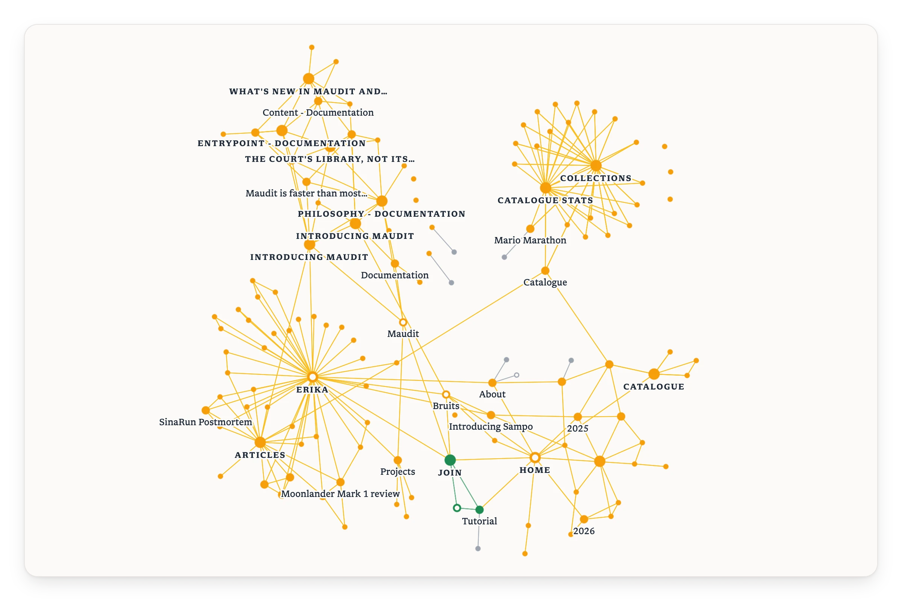

<picture>
  <source media="(prefers-color-scheme: dark)" srcset="./.github/assets/logo_dark.svg" />
  
</picture>

> If you look the right way, you can see that the whole world is a garden.

A protocol, and related tools, to turn web rings into explorable node graphs. Follow the [tutorial](https://garden.bruits.org/tutorial/) to plant your own garden 🪴

<picture>
  <source media="(prefers-color-scheme: dark)" srcset="./.github/assets/screenshot_dark.webp" />
  
</picture>

## Acknowledgements

GraphGarden builds on the work of several open-source projects:

- [lol_html](https://github.com/cloudflare/lol-html), the streaming HTML rewriter the CLI reads pages with
- [graphology](https://graphology.github.io/) and its ForceAtlas2 layout, which hold and arrange the graph in the browser
- [Sigma.js](https://www.sigmajs.org/) which draws it

Thank you to everyone who contributes, or would like to. [CONTRIBUTING.md](./CONTRIBUTING.md) is the place to start, and questions are welcome on [Discord](https://discord.com/invite/84pd4QtmzA).

GraphGarden is dedicated to the indie web and its web rings, which shaped my teenage years, and which am happy to see coming back. Its name and quote honour Frances Hodgson Burnett's _The Secret Garden_, a book I loved as a child.

GraphGarden is an open-source project born from [Bruits](https://bruits.org/), a Rust-focused collective 💛
